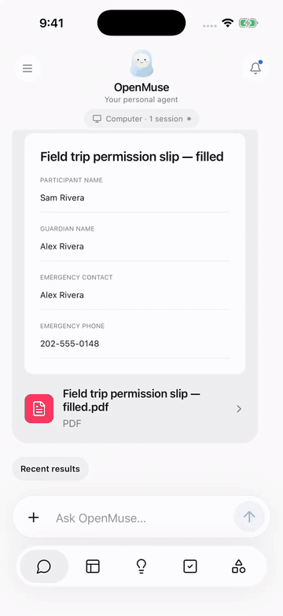

<div align="center">

# OpenMuse Standalone

**Self-hosted OpenMuse: a personal AI agent whose conversations live in your own Postgres, not a hosted chat cloud.**

*个人 AI agent 的独立版：对话存在你自己的 Postgres 里，不依赖托管聊天云。*

[](https://github.com/caspianchan31/openmuse-standalone/actions/workflows/ci.yml)
[](LICENSE)
[](https://github.com/caspianchan31/openmuse-standalone/releases)


[Quick start](#quick-start-no-key) · [Upstream vs Standalone](#upstream-vs-standalone) · [Known limits](#known-limits) · [Changelog](CHANGELOG.md) · [How it is built](docs/STANDALONE.md) · [中文](#中文)



</div>

**In one line:** a fork of [CopilotKit's OpenMuse](https://github.com/CopilotKit/openmuse) that stores every conversation in your own Postgres (embedded PGlite by default), streams replies over SSE from your own server, and runs without a CopilotKit Intelligence key.

<p align="center">
  
  &nbsp;&nbsp;
  
</p>

<p align="center"><sub>The demo and screenshots show the OpenMuse app in its fictional sample workspace (iPhone). They show the app as a whole, not the chat storage that Standalone changes. <a href="assets/openmuse-demo.mp4">Full-quality MP4</a>.</sub></p>

> **Alpha.** This is v0.1.0 of a fork of an alpha project. Expect rough edges; see [Status](#status) and [Known limits](#known-limits).

> Looking for the full OpenMuse guide (demo, features, Render, Google, browser worker, Linux computer)? It is kept as [docs/UPSTREAM-README.md](docs/UPSTREAM-README.md). This page covers what OpenMuse Standalone changes.

[OpenMuse](https://github.com/CopilotKit/openmuse) is a personal agent with a browser, a cloud desktop, files and background work. Upstream, its chat layer stores every conversation in CopilotKit Intelligence, a hosted service: when that service is down, you cannot talk to your agent, and your conversation text lives on someone else's servers.

This fork keeps everything OpenMuse does and moves the chat layer in-house:

- Conversations, thread lists and the main chat are stored in your own Postgres (embedded PGlite by default).
- The agent streams replies straight from your server to your browser (SSE), with no relay through a hosted gateway.
- The model call, the cloud desktop (E2B), mail, calendar and files already ran on your own keys upstream; they are unchanged.
- Everything else tracks upstream OpenMuse. Set `CPK_INTELLIGENCE_API_KEY` and it behaves exactly like upstream.

## Status

**v0.1.0, released 2026-10-11.** Alpha, like upstream. Based on upstream OpenMuse `main` at `1ac68f3` (2026-10-06). See the [changelog](CHANGELOG.md) and [how it is built](docs/STANDALONE.md).

## Upstream vs Standalone

Compared against upstream OpenMuse `main` at `1ac68f3` (2026-10-06), the commit this fork is based on. Upstream may have changed since; see [issue #73](https://github.com/CopilotKit/openmuse/issues/73) for its current discussion.

| | Upstream OpenMuse | OpenMuse Standalone |
|---|---|---|
| Where conversations are stored | CopilotKit Intelligence (hosted) | Your own Postgres or embedded PGlite (no key). With `CPK_INTELLIGENCE_API_KEY` set: Intelligence, as upstream |
| `CPK_INTELLIGENCE_API_KEY` | Required to chat | Optional |
| Chat without the key | Fails: "Main conversation is unavailable", "Failed to initialize thread" | Works: local mode |
| If the hosted chat service is down | You cannot talk to your agent | Local mode does not use it |
| How replies stream | Intelligence runtime | SSE straight from your server |
| Reload mid-reply resumes the reply | Yes | Yes |
| Thread list updates live on other devices | Yes | No: refreshes when the menu opens |
| Memories | Yes | Not served in local mode |
| Browser, Linux computer, Gmail/Calendar, tasks, ideas, goals | Yes | Unchanged from upstream |
| Replies interrupted by a crash | n/a | Recovered at startup (PGlite) or after the lock goes stale (Postgres) |
| Optional retention | n/a | `CHAT_RETENTION_DAYS` |
| Maturity | Alpha | Alpha (v0.1.0, 2026-10-11); `render.yaml` has not been exercised on Render |
| License | MIT | MIT (Intelligence is a separate service, not covered) |

Local mode removes the hosted *chat* layer only. Model calls, optional Gmail/Calendar/E2B, default web search and SDK telemetry still behave as upstream; see [What still leaves your server](#what-still-leaves-your-server).

## Quick start (no key)

**Requirements:** Node 24 LTS and pnpm 11.19.0. The sample workspace needs no model, Google account, Docker or CopilotKit Intelligence key.

```sh
git clone https://github.com/caspianchan31/openmuse-standalone.git openmuse
cd openmuse
pnpm install --frozen-lockfile
cp .env.example .env   # leave CPK_INTELLIGENCE_API_KEY unset
pnpm dev               # API on http://localhost:8787
```

In another terminal:

```sh
pnpm dev:web           # app on http://localhost:8081
```

Send a message, reload the page mid-reply, and the reply resumes; open the thread menu to list, rename, archive or restore conversations. All of it is served by your API from its own database.

**Production build:**

```sh
pnpm build:server && pnpm start   # API (and the in-process task worker)
pnpm build:web                     # static web export in apps/mobile/dist/web
```

Set `EXPO_PUBLIC_API_URL` to the API's public URL when building the web app. A server reachable from other machines needs live mode (`WORKSPACE_MODE=live`, `OPENMUSE_ACCESS_KEY`, `TOKEN_ENCRYPTION_KEY`) and a model; see [Configure the agent and Google](docs/UPSTREAM-README.md#configure-the-agent-and-google). [render.yaml](render.yaml) is upstream's Blueprint with the key marked optional; it has not been exercised on Render for this release.

### Chat settings

| Variable | Default | Effect |
|---|---|---|
| `CPK_INTELLIGENCE_API_KEY` | unset | Unset or blank: **local mode**, conversations in this server's database. Set: upstream's CopilotKit Intelligence mode, unchanged. A wrong key reports errors; it never falls back to local mode. |
| `DATABASE_URL` | unset | Unset: embedded PGlite in `DATA_DIR/postgres`. Set: that Postgres server. |
| `DATA_DIR` | `.openmuse` | Embedded database, documents, signing key and browser profiles. Keep it private and back it up. |
| `CHAT_RETENTION_DAYS` | unset (keep forever) | Local mode only: delete finished replies older than this many days. A whole number from 1 to 36500. |

Everything else (model, provider keys, Google, browser worker, computer) is configured as upstream: [.env.example](.env.example).

### PGlite or Postgres

- **Embedded PGlite (default).** Nothing to install. One process owns the database, so run the task worker inside the API (the default). A reply cut off by a crash is recovered as soon as the API starts again.
- **Postgres (`DATABASE_URL`).** Recommended for a server you depend on. Back it up like any application data. A separate task worker (`pnpm start:worker`) can share it. A reply cut off by a crash is recovered after its lock goes stale, within about 30 to 45 seconds.

The chat tables (`chat_threads`, `chat_runs`, `chat_events`) are created on startup in either database. A step-by-step walkthrough for `DATABASE_URL`, including the separate task worker, is in [docs/POSTGRES.md](docs/POSTGRES.md).

### With and without `CPK_INTELLIGENCE_API_KEY`

| | No key (local mode) | Key set (Intelligence) |
|---|---|---|
| Where conversations live | This server's Postgres or PGlite | CopilotKit Intelligence |
| How replies stream | SSE from this server | Upstream's Intelligence runtime |
| Thread menu: list, rename, archive, restore | Served by this API (`/api/copilotkit/threads*`, which also deletes a thread) | Intelligence |
| Main conversation (`/api/main-thread`) | Recorded in this database | Intelligence |
| Reload replays the conversation; reload mid-reply resumes it | Yes | Yes |
| Send while a reply is running | Held by the app (`409 agent_thread_locked`) | Held by the app (`AgentThreadLockedError`) |
| Thread list updates live on other devices | No: refreshes when the menu opens | Yes |
| `GET /api/workspace` → `runtime.threads` | `"local"` | `"intelligence"` |

### Moving from CopilotKit Intelligence

Remove `CPK_INTELLIGENCE_API_KEY` (or leave it blank) and restart the API. **Cloud threads are not imported automatically.** They stay in Intelligence and reappear if you set the key again. In local mode the main conversation keeps its id but starts empty, and new conversations are saved locally. Conversations saved locally are likewise never uploaded to Intelligence.

### What still leaves your server

Local mode removes the hosted chat layer. These are separate and work as upstream:

- Model calls go to the provider you configure.
- Public web search uses Parallel's keyless Search MCP by default; set `WEB_SEARCH_ENABLED=false` to turn it off.
- The CopilotKit SDK sends runtime telemetry by default; set `COPILOTKIT_TELEMETRY_DISABLED=true` or `DO_NOT_TRACK=1` to opt out ([details](docs/TELEMETRY.md)).
- Gmail, Calendar and the E2B cloud desktop, only if you enable them.

### Known limits

- **No cross-device live thread metadata sync.** Another device's thread list refreshes when its menu opens, not live.
- **Single-instance run lock.** Run one API process. A reply resumes live only from the API process that runs it; a reload served by another process shows the reply's progress so far, then ends.
- A message held because another device was replying is sent later with this device's copy of the conversation, so the model does not see the other device's turn (the saved history is in order, and a reload shows it).
- Memories are not served in local mode; automatic thread names are off in both modes, as upstream.

## How it works

Without a key, the CopilotKit runtime runs in SSE mode on OpenMuse's own `AgentRunner`, backed by the app's database. The API serves the thread routes itself, refuses a second run on a busy thread with `409` before any stream starts, recovers replies interrupted by a crash, and can expire old history. Architecture and upstream merging: [docs/STANDALONE.md](docs/STANDALONE.md). Configuration, routes, schema and validation: [docs/STANDALONE-THREADS.md](docs/STANDALONE-THREADS.md).

## Why not just patch the config

The upstream runtime has no local fallback: without the hosted service, opening the chat fails with "Main conversation is unavailable" and every message fails with "Failed to initialize thread". Switching the runtime to SSE mode requires a thread store of its own, which is what this fork adds.

## Relationship to upstream

MIT, like upstream. Changes are kept small and marked (`// Standalone:` comments, new logic in `apps/server/src/standalone/`), so the fork can keep merging upstream. Upstream is discussing the same need in [issue #73](https://github.com/CopilotKit/openmuse/issues/73), with proposals in [#94](https://github.com/CopilotKit/openmuse/pull/94) and [#166](https://github.com/CopilotKit/openmuse/pull/166). If upstream adds a first-party local thread store, this fork will adopt it.

CopilotKit Intelligence is a separate service and is not part of this repository or its MIT license.

## License

[MIT](LICENSE), Copyright (c) 2026 OpenMuse contributors.

---

## 中文

**OpenMuse 独立版：整套跑在自己的服务器上，不依赖第三方聊天云。**

上游 OpenMuse 的聊天层把所有对话存在 CopilotKit Intelligence 托管服务里：它一挂，你就没法和 agent 说话；对话文本也在别人的服务器上。本分支把聊天层收回自己手里（Postgres 存线程、服务端直接用 SSE 流式回浏览器），其余功能与上游一致，持续跟进上游。设置了 `CPK_INTELLIGENCE_API_KEY` 时，行为与上游完全相同。

**现状**：v0.1.0，2026-10-11 发布，alpha（与上游一致）。基于上游 `main` 的 `1ac68f3`（2026-10-06）。上游完整说明见 [docs/UPSTREAM-README.md](docs/UPSTREAM-README.md)。

### 快速开始（不需要 key）

需要 Node 24 LTS 和 pnpm 11.19.0；示例工作区不需要模型、Google 账号、Docker 或 Intelligence key。

```sh
git clone https://github.com/caspianchan31/openmuse-standalone.git openmuse
cd openmuse
pnpm install --frozen-lockfile
cp .env.example .env   # 不要设置 CPK_INTELLIGENCE_API_KEY
pnpm dev               # API：http://localhost:8787
pnpm dev:web           # 另开一个终端，应用：http://localhost:8081
```

生产环境：`pnpm build:server && pnpm start`；网页用 `pnpm build:web`（构建时设 `EXPO_PUBLIC_API_URL`）。对外开放的服务器需要 live 模式（`WORKSPACE_MODE=live`、`OPENMUSE_ACCESS_KEY`、`TOKEN_ENCRYPTION_KEY`）和模型配置，见上游说明。

### 环境变量

- `CPK_INTELLIGENCE_API_KEY`：不设或留空即**本地模式**，对话存在本服务器数据库；设置后走上游 Intelligence 模式，行为不变。key 填错会报错，不会退回本地模式。
- `DATABASE_URL`：不设则用内嵌 PGlite（`DATA_DIR/postgres`）；设置则连该 Postgres。
- `DATA_DIR`：默认 `.openmuse`，存数据库、文件、签名密钥，需自行备份。
- `CHAT_RETENTION_DAYS`：仅本地模式，删除超过该天数的已完成回复（1–36500 的整数）；不设则永久保留。

### PGlite 与 Postgres

- **PGlite（默认）**：免安装；数据库只能被一个进程打开，任务 worker 跑在 API 进程里。崩溃中断的回复在 API 重启时立即恢复。
- **Postgres**：长期使用推荐；可让独立任务 worker 共用。崩溃中断的回复在锁过期后约 30–45 秒内恢复。配置 `DATABASE_URL` 的分步说明见 [docs/POSTGRES.md](docs/POSTGRES.md)（英文）。

### 有无 key 的区别

不设 key：对话、线程菜单（列出、改名、归档、恢复）、主对话都由本服务器提供（删除线程走 `DELETE /api/copilotkit/threads/:id`）；刷新会重放对话，回复中途刷新会接着播；回复进行中再发消息返回 `409 agent_thread_locked`，应用把消息暂存。设置 key：全部走 Intelligence，与上游一致，另有跨设备实时线程列表。

### 从云端迁移

去掉 `CPK_INTELLIGENCE_API_KEY` 后重启即可。**云端已有的线程不会自动导入**，仍留在 Intelligence，重新设 key 就能看到；本地模式下主对话 id 不变但从空白开始。本地保存的对话也不会上传到 Intelligence。

### 仍会离开服务器的数据

模型调用（发往你配置的模型商）；公共网页搜索默认走 Parallel（`WEB_SEARCH_ENABLED=false` 关闭）；CopilotKit SDK 遥测默认开启（`COPILOTKIT_TELEMETRY_DISABLED=true` 或 `DO_NOT_TRACK=1` 关闭）；Gmail、日历、E2B 云桌面仅在你启用时使用。

### 已知限制

- **不支持跨设备实时同步线程元数据**：其他设备的线程列表在打开菜单时刷新。
- **单实例运行锁**：只运行一个 API 进程；回复只能从正在运行它的进程实时续播。
- 因另一台设备正在回复而暂存的消息，稍后会带着本设备的对话副本发送，模型看不到另一台设备那一轮（保存的历史顺序正确，刷新可见）。
- 本地模式不提供 Memories；两种模式都不自动命名线程（与上游一致）。

架构与跟进上游的方法见 [docs/STANDALONE.zh-CN.md](docs/STANDALONE.zh-CN.md)（英文原文：[docs/STANDALONE.md](docs/STANDALONE.md)）。MIT 许可，与上游相同；CopilotKit Intelligence 是独立服务，不在本仓库及其 MIT 许可范围内。
