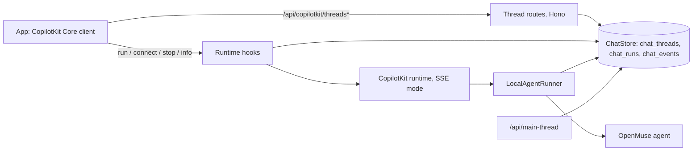

# OpenMuse Standalone: architecture

OpenMuse Standalone is upstream [OpenMuse](https://github.com/CopilotKit/openmuse) plus a self-hosted chat layer. One setting selects the chat layer:

- **`CPK_INTELLIGENCE_API_KEY` unset or blank (local mode).** The CopilotKit runtime runs in SSE mode on OpenMuse's own persistent `AgentRunner`. Conversations live in the app's own database (embedded PGlite or `DATABASE_URL`), and the API serves the thread routes itself.
- **Key set.** The runtime runs in Intelligence mode exactly as upstream, so this repository keeps merging upstream without drift.

This page explains how local mode is built and how to keep merging upstream. The operator reference (routes, response codes, tables, timings, validation) is [STANDALONE-THREADS.md](STANDALONE-THREADS.md).



## Design choice

The CopilotKit runtime offers two seams for a self-hosted thread store. `LocalThreadEndpointRunner` would let the runtime serve the thread list itself, but its methods are synchronous, and a store backed by Postgres cannot answer synchronously. OpenMuse Standalone therefore:

1. implements only the asynchronous `AgentRunner` contract (`run`, `connect`, `isRunning`, `stop`), backed by the app's own database, and
2. serves every `/api/copilotkit/threads*` route in the Hono layer, before the runtime handler, filtered by the authenticated owner, and rewrites `/info.threadEndpoints` so the client uses them.

Nothing is held only in memory: the thread lock, the running reply and the finished history are all in the database.

## Components

All new server logic is in `apps/server/src/standalone/`. `createStandaloneChat` (`index.ts`) builds it once per app when no key is set.

| File | Role |
|---|---|
| `chat-store.ts` | `ChatStore`: the `chat_threads`, `chat_runs` and `chat_events` tables, created on startup in PGlite or Postgres. Every change that touches several rows is one SQL statement. |
| `runner.ts` | `LocalAgentRunner`: runs the agent, journals the running reply, saves it, replays history on connect, stops, and recovers stale locks. Semantics follow the runtime's `InMemoryAgentRunner` (1.70.1). |
| `runtime-hooks.ts` | `onBeforeHandler` / `onResponse` hooks around the runtime's own router: owner checks, the busy-thread 409, claim release, the `/info` rewrite. |
| `thread-routes.ts` | List, messages, events, state, rename, archive/restore and delete, scoped to the session owner. |
| `events.ts` | Pure helpers over AG-UI events: compaction, message and state reconstruction, replay shaping. |
| `types.ts` | The contract between the store, the runner and the HTTP layer. |

`/api/main-thread` records the owner's main thread in `chat_threads` instead of calling Intelligence `getOrCreateThread`. `/api/workspace` reports `runtime.threads` (`"local"` or `"intelligence"`), and `runtime.richThreads` is `true` in both modes, so the app shows the same thread menu, main conversation and replay either way.

On the client (`apps/mobile/src/`), local mode still goes through `copilotkit.connectAgent`, so a reload resumes a reply in flight. `local-thread.ts` clears the agent before each connect (the server replays the whole thread, as there is no replay cursor), and `conversation-run.ts` recognises the HTTP 409 as the same thread lock that Intelligence reports, so a queued message is held instead of failing.

## A run, step by step

1. The app posts a run. The runtime routes it; the `onBeforeHandler` hook runs before any response byte.
2. The hook claims the thread for the session owner in `chat_threads` (`run_id`, holder, heartbeat). A thread owned by someone else answers `404`; a missing, empty or over-long `threadId`/`runId` answers `400`; a database failure answers `503`. Nothing is claimed in those cases.
3. **Busy thread:** if the thread is already replying, the hook answers `409 {"error": "...", "code": "agent_thread_locked"}` before any `200` SSE response. The app already understands this code (it is what Intelligence reports as `AgentThreadLockedError`), so the queued message is held, not shown as an error.
4. The runtime calls `LocalAgentRunner.run`. Events stream to the app over SSE while the runner journals them to `chat_events` every 250 ms (or every 64 events) and refreshes the lock's heartbeat every 5 seconds.
5. When the agent finishes, the runner compacts the reply and saves it to `chat_runs`. Only then does the app receive `RUN_FINISHED` (or `RUN_ERROR`). If the save fails, the stream ends with `RUN_ERROR` code `persistence_failed`, never with a reply the app shows but the server lost.
6. If the runtime answers anything but `200` (bad body, unknown agent), `onResponse` releases the claim, and a thread row that never ran is removed.

`connect` replays the thread's saved replies, then follows the reply in progress if this process runs it. `stop` aborts the agent, saves what it said so far as `stopped`, and ends the stream.

## Crash recovery

A reply whose lock has no heartbeat for 30 seconds is recovered by a sweep that runs every 15 seconds: the journal is saved as an `interrupted` reply and the thread is unlocked. With embedded PGlite, no other process can hold a lock, so every lock left by the previous process is recovered at startup. With `DATABASE_URL`, recovery waits for the heartbeat to go stale (about 30 to 45 seconds after a crash). On `SIGINT`/`SIGTERM` the API saves replies in progress as interrupted before closing.

## Retention and compaction

Each finished reply is stored once, compacted: text and tool-call chunks are merged, state deltas collapse into one `STATE_SNAPSHOT`, and the run's first event carries only the messages that were new to the thread. The `chat_events` journal holds only replies still running and is cleared when a reply is saved or recovered. With `CHAT_RETENTION_DAYS=N`, the sweep deletes finished replies older than N days; thread rows and names stay. Deleting a thread removes its replies and journal.

## Owner isolation

Every thread belongs to the owner whose session created it. Another owner's thread id is answered exactly like a missing thread (`404`) on the thread routes and on run, connect and stop, and a refused run takes no lock. Owner fields in request bodies are ignored; the owner always comes from the verified session. The runtime's debug event stream answers `404` in local mode because it would carry every owner's events.

## Keeping up with upstream

This repository is upstream OpenMuse plus the standalone commits. Changes to upstream files are small and marked with `// Standalone:` comments; new logic lives in new files.

```sh
git remote add upstream https://github.com/CopilotKit/openmuse.git   # once
git fetch upstream
git merge upstream/main
pnpm install --frozen-lockfile
pnpm typecheck && pnpm exec biome check . && pnpm test
```

Where conflicts appear:

| File | What to do |
|---|---|
| `README.md` | Keep this repository's README. Port upstream's README changes into [UPSTREAM-README.md](UPSTREAM-README.md), adjusting relative links for `docs/`. |
| `apps/server/src/config.ts`, `tests/config.test.ts` | Keep the key optional (`chatBackend`, a no-op `assertApiDeploymentConfig`, `CHAT_RETENTION_DAYS`). Keep upstream's assertions for the keyed path; the keyless tests are additions. |
| `apps/server/src/app.ts`, `agent.ts`, `index.ts`, `worker-entry.ts`, `workspace.ts`, `db.ts`, `demo/entry.ts` | Re-apply each `// Standalone:` hunk around upstream's change. Each is a branch on whether a key is set. |
| `apps/mobile/src/chat.tsx`, `conversation-run.ts`, `screens.tsx`, `packages/domain/src/index.ts` | Re-apply the `// Standalone:` hunks: `connectThread`, the HTTP 409 lock check, the Settings line, `runtime.threads`. |
| `.env.example`, `render.yaml`, `CONTRIBUTING.md`, `docs/*.md` | Keep the "key is optional" wording. |

When upgrading `@copilotkit/runtime` or `@ag-ui/*`, check the `AgentRunner` contract, `CopilotRuntimeHooks`, the `/info` `threadEndpoints` shape and the `agent_thread_locked` code. The standalone tests (`tests/standalone-*.test.ts`, `apps/mobile/test/*`) run them through the real runtime and the app's real CopilotKit client, so a breaking upgrade fails the suite.

Upstream is discussing the same need in [issue #73](https://github.com/CopilotKit/openmuse/issues/73), with proposals in [#94](https://github.com/CopilotKit/openmuse/pull/94) and [#166](https://github.com/CopilotKit/openmuse/pull/166). If upstream ships a first-party local thread store, this repository will move to it and provide a migration for the `chat_*` tables.
