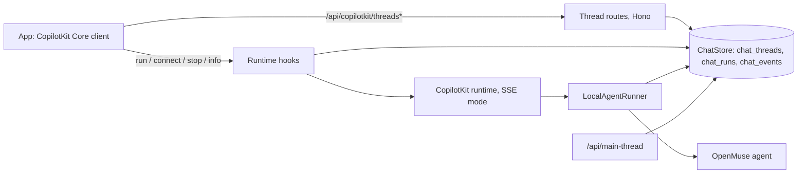

# OpenMuse 独立版：架构

> 本文是 [STANDALONE.md](STANDALONE.md) 的简体中文（zh-CN）译文。代码、文件名、表名、错误码（如 `agent_thread_locked`）以及 Mermaid 图的标识符均保留英文；如译文与英文原文存在歧义，以英文原文为准。

OpenMuse 独立版（Standalone）是上游 [OpenMuse](https://github.com/CopilotKit/openmuse) 再加一层自托管聊天层。一个设置项即可选择聊天层：

- **`CPK_INTELLIGENCE_API_KEY` 未设置或留空（本地模式）。** CopilotKit 运行时以 SSE 模式运行在 OpenMuse 自己的持久化 `AgentRunner` 上。对话保存在应用自己的数据库中（内嵌 PGlite 或 `DATABASE_URL`），线程相关路由由 API 自己提供。
- **设置了 key。** 运行时与上游完全一样，以 Intelligence 模式运行，因此本仓库可以持续合入上游而不产生偏移。

本页说明本地模式是如何构建的，以及如何持续合入上游。运维参考（路由、响应码、表、时序、校验）见 [STANDALONE-THREADS.md](STANDALONE-THREADS.md)。



## 设计选择

CopilotKit 运行时为自托管线程存储提供了两个接缝（seam）。`LocalThreadEndpointRunner` 本可以让运行时自己提供线程列表，但它的方法是同步的，而基于 Postgres 的存储无法同步响应。因此 OpenMuse 独立版：

1. 只实现异步的 `AgentRunner` 契约（`run`、`connect`、`isRunning`、`stop`），由应用自己的数据库支撑；并且
2. 在 Hono 层、运行时处理器之前提供每一条 `/api/copilotkit/threads*` 路由，按已认证的 owner 过滤，并重写 `/info.threadEndpoints`，让客户端改用这些路由。

没有任何状态只保存在内存中：线程锁、正在进行的回复和已完成的历史都在数据库里。

## 组件

所有新增的服务端逻辑都在 `apps/server/src/standalone/` 中。`createStandaloneChat`（`index.ts`）在未设置 key 时为每个应用构建一次。

| 文件 | 职责 |
|---|---|
| `chat-store.ts` | `ChatStore`：`chat_threads`、`chat_runs` 和 `chat_events` 三张表，启动时在 PGlite 或 Postgres 中创建。任何涉及多行的改动都用一条 SQL 语句完成。 |
| `runner.ts` | `LocalAgentRunner`：运行 agent、记录正在进行的回复日志、保存回复、在 connect 时重放历史、停止以及回收过期锁。语义遵循运行时的 `InMemoryAgentRunner`（1.70.1）。 |
| `runtime-hooks.ts` | 围绕运行时自身路由器的 `onBeforeHandler` / `onResponse` 钩子：owner 检查、忙线程 409、释放认领、`/info` 重写。 |
| `thread-routes.ts` | 列出、消息、事件、状态、改名、归档/恢复和删除，均限定在会话 owner 范围内。 |
| `events.ts` | 基于 AG-UI 事件的纯函数辅助工具：压缩、消息与状态重建、重放塑形。 |
| `types.ts` | 存储、runner 与 HTTP 层之间的契约。 |

`/api/main-thread` 把 owner 的主线程记录在 `chat_threads` 中，而不是调用 Intelligence 的 `getOrCreateThread`。`/api/workspace` 上报 `runtime.threads`（`"local"` 或 `"intelligence"`），并且两种模式下 `runtime.richThreads` 都为 `true`，因此无论哪种模式，应用都显示相同的线程菜单、主对话和重放。

在客户端（`apps/mobile/src/`），本地模式仍通过 `copilotkit.connectAgent` 连接，所以刷新页面可以续播正在进行的回复。`local-thread.ts` 在每次 connect 前清空 agent（服务端会重放整个线程，因为没有重放游标），`conversation-run.ts` 把 HTTP 409 识别为 Intelligence 上报的同一个线程锁，因此排队的消息会被暂存，而不是报错。

## 一次运行的完整流程

1. 应用发起一次 run。运行时为其路由；`onBeforeHandler` 钩子在任何响应字节之前运行。
2. 钩子在 `chat_threads` 中为会话 owner 认领该线程（`run_id`、持有者、心跳）。属于他人的线程返回 `404`；缺失、为空或过长的 `threadId`/`runId` 返回 `400`；数据库故障返回 `503`。这些情况下都不会发生认领。
3. **忙线程：** 如果该线程已在回复，钩子会在任何 `200` SSE 响应之前返回 `409 {"error": "...", "code": "agent_thread_locked"}`。应用本来就认识这个码（Intelligence 将其上报为 `AgentThreadLockedError`），所以排队的消息会被暂存，而不是显示为错误。
4. 运行时调用 `LocalAgentRunner.run`。事件通过 SSE 流式返回给应用，runner 同时每 250 ms（或每 64 个事件）把事件记入 `chat_events` 日志，并每 5 秒刷新一次锁的心跳。
5. agent 完成后，runner 压缩回复并保存到 `chat_runs`。只有在这之后应用才会收到 `RUN_FINISHED`（或 `RUN_ERROR`）。如果保存失败，流以 `RUN_ERROR`、错误码 `persistence_failed` 结束，绝不会出现应用已显示回复、服务端却把回复丢失的情况。
6. 如果运行时返回的不是 `200`（请求体错误、未知 agent），`onResponse` 会释放认领，从未真正运行过的线程行会被删除。

`connect` 先重放该线程已保存的回复；如果本进程正在运行该回复，再跟进正在进行的回复。`stop` 中止 agent，把它到目前为止所说的内容保存为 `stopped`，并结束流。

## 崩溃恢复

一个回复的锁如果 30 秒没有心跳，会由每 15 秒运行一次的清扫任务回收：日志被保存为一条 `interrupted`（已中断）回复，线程随之解锁。使用内嵌 PGlite 时，不可能有其他进程持有锁，所以上一个进程留下的每个锁都会在启动时回收。使用 `DATABASE_URL` 时，恢复要等待心跳过期（崩溃后约 30 到 45 秒）。在 `SIGINT`/`SIGTERM` 时，API 会在关闭前把进行中的回复保存为已中断。

## 保留与压缩

每条已完成的回复只存储一次，并经过压缩：文本块与工具调用块合并，状态增量折叠成一个 `STATE_SNAPSHOT`，run 的第一个事件只携带该线程新增的消息。`chat_events` 日志只保留仍在运行的回复，在回复被保存或回收后清空。设置 `CHAT_RETENTION_DAYS=N` 时，清扫任务会删除超过 N 天的已完成回复；线程行和名称保留。删除线程会一并删除其回复和日志。

## Owner 隔离

每个线程都属于创建它的会话 owner。在线程路由以及 run、connect、stop 上，他人的线程 id 会与缺失线程完全一样地返回（`404`），被拒绝的 run 不会获取锁。请求体中的 owner 字段会被忽略；owner 始终来自已验证的会话。运行时的调试事件流在本地模式下返回 `404`，因为它会携带每个 owner 的事件。

## 跟进上游

本仓库是上游 OpenMuse 加上独立版提交。对上游文件的改动很小，并用 `// Standalone:` 注释标出；新逻辑放在新文件中。

```sh
git remote add upstream https://github.com/CopilotKit/openmuse.git   # once
git fetch upstream
git merge upstream/main
pnpm install --frozen-lockfile
pnpm typecheck && pnpm exec biome check . && pnpm test
```

出现冲突时：

| 文件 | 处理方式 |
|---|---|
| `README.md` | 保留本仓库的 README。把上游 README 的改动移植到 [UPSTREAM-README.md](UPSTREAM-README.md)，并为 `docs/` 调整相对链接。 |
| `apps/server/src/config.ts`、`tests/config.test.ts` | 保持 key 可选（`chatBackend`、空操作的 `assertApiDeploymentConfig`、`CHAT_RETENTION_DAYS`）。保留上游对设置 key 路径的断言；无 key 的测试是新增部分。 |
| `apps/server/src/app.ts`、`agent.ts`、`index.ts`、`worker-entry.ts`、`workspace.ts`、`db.ts`、`demo/entry.ts` | 在上游改动周围重新应用每个 `// Standalone:` 代码块。每一处都是“是否设置了 key”的分支。 |
| `apps/mobile/src/chat.tsx`、`conversation-run.ts`、`screens.tsx`、`packages/domain/src/index.ts` | 重新应用 `// Standalone:` 代码块：`connectThread`、HTTP 409 锁检查、Settings 中的那一行、`runtime.threads`。 |
| `.env.example`、`render.yaml`、`CONTRIBUTING.md`、`docs/*.md` | 保留“key 可选”的措辞。 |

升级 `@copilotkit/runtime` 或 `@ag-ui/*` 时，检查 `AgentRunner` 契约、`CopilotRuntimeHooks`、`/info` 的 `threadEndpoints` 形状以及 `agent_thread_locked` 错误码。独立版测试（`tests/standalone-*.test.ts`、`apps/mobile/test/*`）通过真实运行时和应用真实的 CopilotKit 客户端来运行这些路径，所以破坏性升级会让测试套件失败。

上游也在 [issue #73](https://github.com/CopilotKit/openmuse/issues/73) 中讨论同样的需求，方案见 [#94](https://github.com/CopilotKit/openmuse/pull/94) 和 [#166](https://github.com/CopilotKit/openmuse/pull/166)。如果上游推出官方的本地线程存储，本仓库将迁移到它，并为 `chat_*` 表提供迁移方案。
