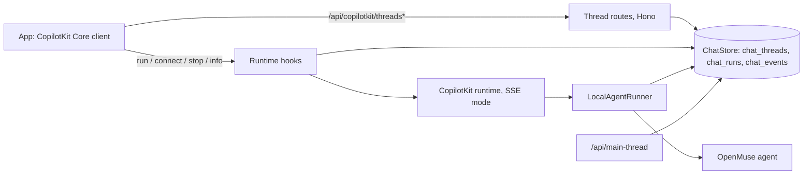

# OpenMuse 独立版：架构

> 本文是 [STANDALONE.md](STANDALONE.md) 的中文翻译。以英文原文为准；代码、文件名、表名、错误码和 mermaid 图中的标识符保留英文。

OpenMuse 独立版 = 上游 [OpenMuse](https://github.com/CopilotKit/openmuse) + 一层自托管的聊天层。由一个设置项决定使用哪一层聊天层：

- **`CPK_INTELLIGENCE_API_KEY` 不设或留空（本地模式）。** CopilotKit runtime 以 SSE 模式运行在 OpenMuse 自己的持久化 `AgentRunner` 上。对话存在应用自己的数据库里（内嵌 PGlite 或 `DATABASE_URL`），线程路由由 API 自己提供。
- **设置了 key。** runtime 以 Intelligence 模式运行，与上游完全相同，因此本仓库可以持续合并上游而不产生偏差。

本页说明本地模式是怎么构建的，以及如何持续合并上游。运维参考（路由、响应码、表、时间参数、验证）见 [STANDALONE-THREADS.md](STANDALONE-THREADS.md)。



## 设计选择

CopilotKit runtime 为自托管线程存储提供了两个接入点。`LocalThreadEndpointRunner` 可以让 runtime 自己提供线程列表，但它的方法是同步的，而以 Postgres 为后端的存储无法同步应答。因此 OpenMuse 独立版：

1. 只实现异步的 `AgentRunner` 契约（`run`、`connect`、`isRunning`、`stop`），以应用自己的数据库为后端；
2. 在 Hono 层、runtime 处理器之前，提供所有 `/api/copilotkit/threads*` 路由，按已认证的 owner 过滤，并改写 `/info.threadEndpoints`，让客户端使用这些路由。

没有任何东西只保存在内存里：线程锁、进行中的回复和已完成的历史全部在数据库中。

## 组件

所有新增的服务端逻辑都在 `apps/server/src/standalone/`。未设置 key 时，`createStandaloneChat`（`index.ts`）为每个应用构建一次。

| 文件 | 作用 |
|---|---|
| `chat-store.ts` | `ChatStore`：`chat_threads`、`chat_runs` 和 `chat_events` 三张表，启动时在 PGlite 或 Postgres 中创建。凡是涉及多行的修改都是一条 SQL 语句。 |
| `runner.ts` | `LocalAgentRunner`：运行 agent，记录进行中回复的日志，保存回复，在 connect 时重放历史，停止，以及恢复过期的锁。语义遵循 runtime 的 `InMemoryAgentRunner`（1.70.1）。 |
| `runtime-hooks.ts` | 包在 runtime 自身路由外的 `onBeforeHandler` / `onResponse` 钩子：owner 检查、线程忙时的 409、释放占用、改写 `/info`。 |
| `thread-routes.ts` | 列出、消息、事件、状态、改名、归档/恢复和删除，限定在会话 owner 范围内。 |
| `events.ts` | 针对 AG-UI 事件的纯函数：压缩、重建消息与状态、整理重放内容。 |
| `types.ts` | 存储、runner 与 HTTP 层之间的契约。 |

`/api/main-thread` 把 owner 的主线程记录在 `chat_threads` 中，而不是调用 Intelligence 的 `getOrCreateThread`。`/api/workspace` 通过 `runtime.threads` 报告模式（`"local"` 或 `"intelligence"`），两种模式下 `runtime.richThreads` 都是 `true`，所以应用在两种模式下显示同样的线程菜单、主对话和重放。

在客户端（`apps/mobile/src/`），本地模式仍然走 `copilotkit.connectAgent`，因此刷新页面可以接上进行中的回复。`local-thread.ts` 在每次 connect 前清空 agent（服务端会重放整个线程，因为没有重放游标）；`conversation-run.ts` 把 HTTP 409 识别为与 Intelligence 报告的同一种线程锁，所以排队的消息会被暂存而不是失败。

## 一次运行的逐步过程

1. 应用发起一次 run。runtime 对它做路由；`onBeforeHandler` 钩子在任何响应字节发出之前运行。
2. 钩子在 `chat_threads` 中为会话 owner 占用该线程（`run_id`、持有者、心跳）。属于别人的线程应答 `404`；`threadId`/`runId` 缺失、为空或过长应答 `400`；数据库故障应答 `503`。这些情况下不会占用任何东西。
3. **线程忙：** 如果线程已经在回复，钩子在任何 `200` SSE 响应之前应答 `409 {"error": "...", "code": "agent_thread_locked"}`。应用已经认识这个错误码（它就是 Intelligence 以 `AgentThreadLockedError` 报告的那个），所以排队的消息会被暂存，而不是显示为错误。
4. runtime 调用 `LocalAgentRunner.run`。事件通过 SSE 流式发送给应用，同时 runner 每 250 ms（或每 64 个事件）把它们记录到 `chat_events`，并每 5 秒刷新一次锁的心跳。
5. agent 完成后，runner 压缩这条回复并保存到 `chat_runs`。只有在这之后应用才会收到 `RUN_FINISHED`（或 `RUN_ERROR`）。如果保存失败，流以错误码为 `persistence_failed` 的 `RUN_ERROR` 结束，绝不会出现应用显示了、服务端却丢了的回复。
6. 如果 runtime 应答的不是 `200`（请求体错误、未知 agent），`onResponse` 释放占用，并删除从未运行过的线程行。

`connect` 重放该线程已保存的回复，然后如果进行中的回复由本进程运行，就接着跟随它。`stop` 中止 agent，把它到目前为止说的内容保存为 `stopped`，并结束流。

## 崩溃恢复

锁的心跳超过 30 秒没有更新的回复，会被每 15 秒运行一次的清扫任务恢复：日志被保存为一条 `interrupted` 回复，线程被解锁。使用内嵌 PGlite 时，没有别的进程能持有锁，因此上一个进程留下的所有锁在启动时就被恢复。使用 `DATABASE_URL` 时，恢复要等心跳过期（崩溃后约 30 到 45 秒）。收到 `SIGINT`/`SIGTERM` 时，API 在关闭前把进行中的回复保存为 interrupted。

## 保留期与压缩

每条已完成的回复只存一次，并经过压缩：文本和工具调用的分块被合并，状态增量折叠为一个 `STATE_SNAPSHOT`，这次 run 的第一个事件只携带对该线程来说是新的消息。`chat_events` 日志只保存仍在运行的回复，在回复被保存或恢复后清空。设置 `CHAT_RETENTION_DAYS=N` 后，清扫任务删除早于 N 天的已完成回复；线程行和名称保留。删除线程会删除它的回复和日志。

## Owner 隔离

每个线程属于创建它的会话所对应的 owner。在线程路由以及 run、connect、stop 上，别的 owner 的线程 id 与不存在的线程得到完全一样的应答（`404`），被拒绝的 run 不会取得锁。请求体中的 owner 字段会被忽略；owner 始终来自已验证的会话。runtime 的调试事件流在本地模式下应答 `404`，因为它会携带所有 owner 的事件。

## 跟进上游

本仓库 = 上游 OpenMuse + 独立版的提交。对上游文件的修改都很小，并用 `// Standalone:` 注释标出；新逻辑放在新文件里。

```sh
git remote add upstream https://github.com/CopilotKit/openmuse.git   # once
git fetch upstream
git merge upstream/main
pnpm install --frozen-lockfile
pnpm typecheck && pnpm exec biome check . && pnpm test
```

出现冲突时：

| 文件 | 怎么做 |
|---|---|
| `README.md` | 保留本仓库的 README。把上游 README 的改动移植到 [UPSTREAM-README.md](UPSTREAM-README.md)，并调整指向 `docs/` 的相对链接。 |
| `apps/server/src/config.ts`、`tests/config.test.ts` | 保持 key 可选（`chatBackend`、空操作的 `assertApiDeploymentConfig`、`CHAT_RETENTION_DAYS`）。保留上游针对有 key 路径的断言；无 key 的测试是新增的。 |
| `apps/server/src/app.ts`、`agent.ts`、`index.ts`、`worker-entry.ts`、`workspace.ts`、`db.ts`、`demo/entry.ts` | 围绕上游的改动重新应用每个 `// Standalone:` 代码块。每一块都是按是否设置了 key 的分支。 |
| `apps/mobile/src/chat.tsx`、`conversation-run.ts`、`screens.tsx`、`packages/domain/src/index.ts` | 重新应用 `// Standalone:` 代码块：`connectThread`、HTTP 409 锁检查、Settings 里的那一行、`runtime.threads`。 |
| `.env.example`、`render.yaml`、`CONTRIBUTING.md`、`docs/*.md` | 保留「key 可选」的措辞。 |

升级 `@copilotkit/runtime` 或 `@ag-ui/*` 时，检查 `AgentRunner` 契约、`CopilotRuntimeHooks`、`/info` 中 `threadEndpoints` 的形状，以及 `agent_thread_locked` 错误码。独立版测试（`tests/standalone-*.test.ts`、`apps/mobile/test/*`）通过真实的 runtime 和应用真实的 CopilotKit 客户端运行它们，所以破坏性的升级会让测试套件失败。

上游正在 [issue #73](https://github.com/CopilotKit/openmuse/issues/73) 讨论同样的需求，提案见 [#94](https://github.com/CopilotKit/openmuse/pull/94) 和 [#166](https://github.com/CopilotKit/openmuse/pull/166)。如果上游发布了官方的本地线程存储，本仓库将迁移过去，并为 `chat_*` 表提供迁移。
