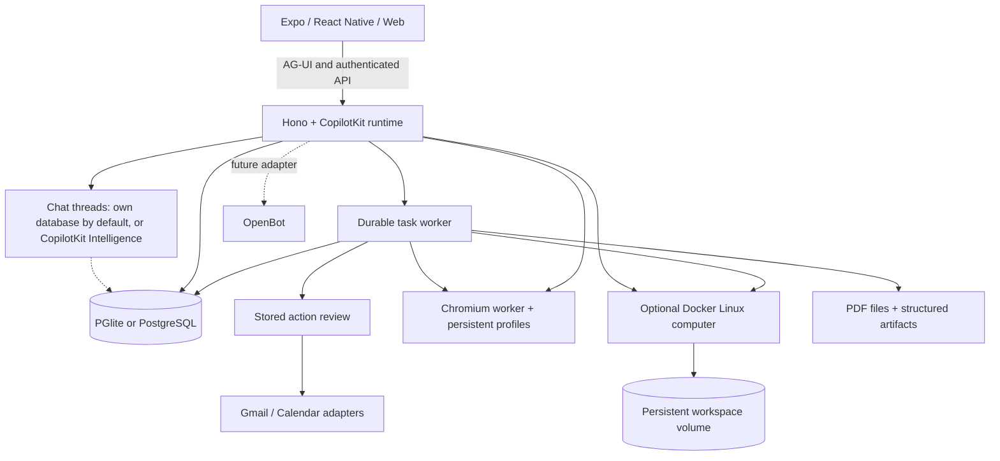

> **Upstream OpenMuse README.** This is the README of [upstream OpenMuse](https://github.com/CopilotKit/openmuse), kept here as the full guide to its features, deployment and configuration. Its chat-thread passages are updated for OpenMuse Standalone, where `CPK_INTELLIGENCE_API_KEY` is optional, and the clone command points at this repository. The badges and the **Deploy to Render** buttons still refer to the upstream repository, which requires the key; to deploy this release, create a Render Blueprint from your copy of this repository. Start with the [OpenMuse Standalone README](../README.md).

<div align="center">

# OpenMuse

**A personal agent with a browser, terminal, files, and work that keeps going. Compatible with any agent harness.**

Ask for an outcome. Follow the plan, review actions, and come back to the result.
Built with CopilotKit React Native for iOS, Android, and web.

[Quick start](#quick-start) · [Demo](#demo) · [Features](#features) · [Architecture](#architecture) · [Docs](README.md) · [Contributing](../CONTRIBUTING.md)

[](https://github.com/CopilotKit/OpenMuse/actions/workflows/ci.yml)
[](../LICENSE)

<a href="https://trendshift.io/repositories/254992?utm_source=trendshift-badge&amp;utm_medium=badge&amp;utm_campaign=badge-trendshift-254992" target="_blank" rel="noopener noreferrer"></a>

[](https://render.com/deploy?repo=https://github.com/CopilotKit/OpenMuse)

Clone this template and customize it however you want.

**[Building on OpenMuse? Meet with the CopilotKit team →](https://www.copilotkit.ai/talk-to-an-engineer?ref=openmuse_hero)**

https://github.com/user-attachments/assets/8014d185-346c-4954-8ff0-26c582c5093a

https://github.com/user-attachments/assets/0cc87de0-c3c1-4f24-b7df-e7d04bb946fd

</div>

> **Alpha, for self-hosting and building on.** Open-ended reasoning and live Google accounts require their own configuration. Conversations are stored on your own server unless you connect CopilotKit Intelligence. See [what is verified](VERIFICATION.md) and the [roadmap](../ROADMAP.md).

## Demo

On iPhone, ask OpenMuse to find interesting stories on Hacker News and summarize CopilotKit. On desktop, ask it to check the school-trip email, open the message, and research exhibits at Monterey Bay Aquarium. The agent shows email and browser results inline. **Take control** opens that same browser session when you need it.

The 38-second iPhone and 42-second desktop web demos show the current interface, framed in 16:9. The send arrow becomes a stop square inside the input pill while the agent replies, then switches back. Stopping keeps your draft intact. See the [recording notes](DEMO.md) for the model setup and reproduction steps.

[Mobile MP4](https://github.com/user-attachments/assets/8014d185-346c-4954-8ff0-26c582c5093a) · [Web MP4](https://github.com/user-attachments/assets/0cc87de0-c3c1-4f24-b7df-e7d04bb946fd) · [Recording details and reproduction](DEMO.md)

The [Jev aquarium-trip demo](demos/jev-generative-ui.md) walks through a fictional school email, clarification choices, sourced exhibit cards, hands-on preference refinement, and a confirmed selection. [Watch the 83-second live Jev recording](../assets/demos/2026-09-23/jev-live-web.mp4), where TypeSafe Jev makes the decisions and a scripted agent keeps the trip scenario repeatable. A [scripted-decision sample recording](../assets/demos/2026-09-23/jev-web.mp4) is also available.

## What it is

OpenMuse is a personal-agent application with an agent computer, visible work, and rich results. It runs its own server, task worker, and browser worker. You can inspect and change the source under the MIT license.

The computer combines **persistent Chromium and an optional Linux workspace**. The agent can browse public pages, run commands in its own container, work with files, and move PDFs between the computer and the app. You can open its browser or terminal and continue the work. Graphical desktops and autonomous checkout remain future work.

## Features

| Surface | What runs in this alpha |
| --- | --- |
| **Chat** | CopilotKit headless chat with streamed AG-UI events, mailbox search and reading, send/stop in one input pill, a visible follow-up queue, retained drafts, delegated tasks, and inline email, browser, PDF, plan, and finance cards. |
| **Agent computer** | Persistent browser profiles and takeover console; optional isolated Linux terminal, saved command receipts, editable workspace files, and PDF transfer. |
| **Activity** | Durable task plans, progress, input requests, pause/resume/cancel/retry, approvals, and saved receipts. SQL leases recover interrupted work. |
| **Ideas** | Suggestions with source evidence; edit, accept, or dismiss. Sent replies and completed matching work are excluded. |
| **Goals & Tracking** | Goals and milestones; recurring public-page checks for changes, text availability, or USD price thresholds, with deduplicated alerts and failure backoff. |
| **Documents** | Email attachment → PDF → requested form values → filled copy → reviewed reply → receipt. Native/web PDF viewing, paging, zoom, supported fields, and sharing. |
| **Finance** | Import transaction CSV to create a spending summary with categories, transactions, and a savings-goal action. |
| **Gmail & Calendar** | Google OAuth adapters, complete mail threads, drafts/attachments, calendar discovery, and reviewed event creation/update/deletion. Live credentials required. |
| **Personal context** | Editable name, tone, avatar, and memories. Background-update preferences and durable in-app notifications. |
| **Rich Threads** | Persistent conversations with a stable main conversation, side chats, renaming, archiving, restoring, and replay. Stored in this server's own database by default, or in CopilotKit Intelligence with a server-only project key. |

The [feature inventory](FEATURES.md) describes implemented capabilities and planned extensions. Health/bank/social connectors, device push, voice, generated executable tools, and automatic reservations/payments are on the [roadmap](../ROADMAP.md).

## Quick start

**Requirements:** Node 24 LTS and pnpm 11.19.0. The local sample app needs no model, Google account, Docker, or CopilotKit Intelligence key: conversations are stored in the API's own database.

```sh
git clone https://github.com/caspianchan31/openmuse-standalone.git openmuse
cd openmuse
pnpm install --frozen-lockfile
cp .env.example .env
# Optional: to store conversations in CopilotKit Intelligence instead of this server, run
# npx copilotkit@latest login && npx copilotkit@latest project select
# and set CPK_INTELLIGENCE_API_KEY (and keep the generated CPK_TELEMETRY_ID) in .env.
pnpm dev
```

In another terminal:

```sh
pnpm dev:web
```

Open [localhost:8081](http://localhost:8081). The API runs at [localhost:8787/api/health](http://localhost:8787/api/health).

### Try it

1. In Chat, send **“Complete the permission slip”**. Open the task, supply fictional form values, inspect the saved PDF, and review the prepared reply. This writes only to the local mailbox.
2. In **Goals → Track**, create a built-in availability watch, then change the built-in test page to trigger an alert.
3. In **Menu → Delegate task → Finance**, use **Try example transactions** to create an interactive spending tracker.
4. Start the [browser worker](#browser-worker) and configure a model, then ask **“Check out Hacker News for cool stuff”** or **“Summarize copilotkit.ai”**. Follow the browser inline and use **Take control** to open its session. For a model-free version of this flow, follow the [AI Mock demo setup](DEMO.md#run-the-agent-browser-demo).

For iOS or Android, use `pnpm --dir apps/mobile ios` or `pnpm --dir apps/mobile android`. Xcode or Android tooling is required. The PDF reader needs an Expo development build; use [native setup](../apps/mobile/README.md).

## Deploy on Render

[](https://render.com/deploy?repo=https://github.com/CopilotKit/OpenMuse)

[render.yaml](../render.yaml) deploys three services: the API, the web app, and a private browser. The API answers `/` with JSON, so the UI is its own static site.

### First run

1. Click **Deploy to Render**. Wait until `openmuse-api`, `openmuse-web`, and `openmuse-browser` are live.
2. On `openmuse-api`, open **Environment** and copy `OPENMUSE_ACCESS_KEY`.
3. Open the `openmuse-web` URL and sign in with that key.
4. Send a message.

The deploy form asks for three values you provide. Render generates the other two.

| Variable | Set by | If it is missing |
|---|---|---|
| `CPK_INTELLIGENCE_API_KEY` | You, optionally. Run `npx copilotkit@latest login`, then `npx copilotkit@latest project select`. Keep it on the server. | Chat threads are stored in the API's own database, on the disk below. |
| `CPK_TELEMETRY_ID` | You. Keep the identity generated by the same project selection. | Runtime usage cannot be attributed to the Intelligence signup account. |
| `OPENAI_API_KEY` | You. Used by the default `openai/gpt-5`. Change `MODEL` and supply the matching provider key for Anthropic or Google. | The model call fails. |
| `OPENMUSE_ACCESS_KEY` | Render | You cannot sign in. |
| `TOKEN_ENCRYPTION_KEY` | Render | The API refuses to start in live mode. |

Health check: `https://<openmuse-api>/api/health`.

### Services

| Service | Plan | What it runs |
|---|---|---|
| `openmuse-api` | Standard, with a 1 GB disk at `/var/data` | The Hono API and the in-process task worker. `DATA_DIR` is `/var/data/openmuse`. |
| `openmuse-web` | Static site | The Expo web export. `EXPO_PUBLIC_API_URL` is baked in at build time. |
| `openmuse-browser` | Private service, Standard, 1 GB disk at `/data` | Playwright and Chromium. The API calls it on the private network. |

**Standard** is the smallest plan that stays up. At 512 MB the process runs out of memory before it binds a port, because PGlite loads an embedded Postgres build.

**The disk** holds the database, PDFs, and the signing key. A redeploy without it wipes that data. Without an Intelligence key, chat threads are in that database too. With a key, chat threads are stored by CopilotKit Intelligence, so a thread can still load after you sign back in even when the disk was never attached.

**Live mode** is required. Render binds `0.0.0.0`, and sample mode rejects any host that is not loopback. The Blueprint sets `WORKSPACE_MODE=live`.

**Browsing is included, and you can take it out.** `openmuse-browser` is a private service, so it has no public URL. The API reaches it at `http://openmuse-browser:8790` with a token Render generates. If the private hostname is not `openmuse-browser`, set `BROWSER_WORKER_URL` to `http://<that-host>:8790`. To deploy without it, delete the `openmuse-browser` service and the `BROWSER_WORKER_URL` and `WORKER_TOKEN` entries on `openmuse-api`. Chat, drafts, and tasks still run. Page reads, screenshots, and **Take control** do not.

The Docker computer and Google mail or calendar need the setup in the sections below. This Blueprint does not start them.

## Configure the agent and Google

Copy the commented settings in [.env.example](../.env.example) into your private `.env`:

1. Set `AGENT_BACKEND=model`, `MODEL=provider/model-id`, and the matching provider key. CopilotKit supports the configured OpenAI, Anthropic or Google provider. Fictional data can still be used with a real model. Provider keys stay on the server.
2. Optionally, store conversations in CopilotKit Intelligence instead of this server: create or select a project with `npx copilotkit@latest login` and `npx copilotkit@latest project select`, and keep the generated `CPK_INTELLIGENCE_API_KEY` on the server.
3. For personal mail/calendar, set `WORKSPACE_MODE=live`, a random `OPENMUSE_ACCESS_KEY` of at least 24 characters, and `TOKEN_ENCRYPTION_KEY` containing 32 random bytes encoded as base64. Restart the API.
4. Configure a Google OAuth web client with Gmail and Calendar APIs enabled. Set `GOOGLE_CLIENT_ID` and `GOOGLE_CLIENT_SECRET`; register `${PUBLIC_API_URL}/api/google/callback` as its redirect URI. Configure consent/test-user access in your Google project.
5. Open **Apps → Gmail** (or **Google Calendar**), connect read access, and grant write access when needed. Every send or calendar change still requires its own stored review. Changing/disconnecting the account invalidates pending connection-bound work.

Google credentials are encrypted at rest. File URLs and browser consoles use short-lived signatures. This deployment uses one owner protected by a shared access key; it is not a multi-tenant authentication system. Use HTTPS and restricted network access for a remote host. Keep the default local-data mode on loopback.

## Public web search

Web search is enabled by default. Set `WEB_SEARCH_ENABLED=false` on the API and any separate task worker to disable it. With a configured model, delegated tasks and built-in model chat (`AGENT_BACKEND=model`) use [Parallel's free, keyless Search MCP](https://docs.parallel.ai/integrations/mcp/search-mcp) as their built-in search provider. Ask, for example, “Find the official CopilotKit React Native setup instructions and cite the sources.” Results include source URLs and excerpts; delegated tasks save them as evidence. Scripted sample chat and external AG-UI conversations keep their existing tools.

Search sends model-generated queries and context, which may include information from your conversation or task, plus a random per-chat/task session identifier to Parallel. See [Parallel's privacy policy](https://parallel.ai/privacy-policy). Free access is rate limited; failures are reported without a paid fallback. Stopping chat or interrupting a task cancels its search.

## Browser worker

Set `BROWSER_WORKER_URL=http://127.0.0.1:8790` and a random `WORKER_TOKEN` of at least 32 characters in `.env`.

```sh
pnpm --dir apps/worker exec playwright install chromium
pnpm dev:browser
```

Or use `docker compose --env-file .env -f infra/compose.yaml up --build -d`. The same token must reach the API and worker. Sessions have persistent Chromium profiles; the app can open a live screenshot console and import PDF downloads. Agent tools can read public pages and hand interactive work to the person. [Worker setup and boundaries](../apps/worker/README.md).

## Persistence and operation

### Linux terminal and workspace

Build the computer image, enable it on the API, then open **Computer → Terminal → Start computer**:

```sh
docker build -t openmuse-computer:local apps/computer
COMPUTER_ENABLED=true pnpm dev
```

The API needs access to the Docker CLI and engine. Commands run in a nonroot container with no host-directory mounts or credentials. A named `/workspace` volume retains files when stopped. Terminal networking is disabled; public web access uses the browser worker. Commands have a 30-second limit and saved output/exit receipts. **Files** supports folders, text editing, and PDF transfer to/from Documents. This is a Linux container, not a full operating-system VM. [Setup, Colima option, and boundaries](COMPUTER.md).

### Application storage

By default, embedded PGlite (including chat threads in local mode), documents and the signing key live in `.openmuse/`; browser profiles live in `.openmuse/browser-profiles/`. Keep that directory private and back it up. The API hosts the task worker. The host must remain running for background work.

For a separate task worker, configure the same `DATABASE_URL`, secrets and shared `DATA_DIR` for both processes, then set `TASK_WORKER_ENABLED=false` on the API and run `pnpm dev:worker`. PGlite cannot be opened by separate processes. Production commands are `pnpm build:server`, `pnpm start` and `pnpm start:worker`. Run one API instance; task workers coordinate through SQL leases.

No hidden retry occurs after an uncertain external write. Review its provider outcome before creating a replacement. Pausing/cancelling prevents subsequent task steps; an already approved in-flight provider request may finish.

## CopilotKit Rich Threads

Conversations are persistent in two ways, chosen by one setting. The native menu uses `useThreads` in both; rich tool results link back to saved tasks, documents, and browser sessions.

**Local mode (default, no key).** OpenMuse runs entirely on your own server: conversations are stored in the API's own Postgres (embedded PGlite or `DATABASE_URL`), and no third-party chat cloud is used. The CopilotKit runtime runs in SSE mode with OpenMuse's own persistent runner, and the API serves the thread menu itself: list, rename, archive, restore, delete, replay after a reload, and resuming a reply after a reload. A send while a reply is running is held, as in Intelligence. Set `CHAT_RETENTION_DAYS` to delete finished replies older than that many days; unset keeps history forever. Limits: the thread list on another device refreshes when its menu opens, not live; a reply resumes live only from the API process that runs it, so run one API instance. SDK telemetry is separate; see [signup and runtime tracking](#signup-and-runtime-tracking) for the opt-out. [Configuration, schema, recovery, and owner isolation](STANDALONE-THREADS.md).

**CopilotKit Intelligence (optional key).** Set `CPK_INTELLIGENCE_API_KEY` on the API server for Intelligence conversation persistence and replay, with realtime thread metadata. Create or select a project with `npx copilotkit@latest login` and `npx copilotkit@latest project select`, set the generated server-only key, and restart the API. Behavior is unchanged from upstream OpenMuse; a wrong key reports errors rather than falling back. Threads do not move between modes.

Intelligence is a separate service and is not included in this repository's MIT license. No project key is shipped. [Configuration and validation boundaries](RICH-THREADS.md).

## Signup and runtime tracking

The CopilotKit SDK sends runtime telemetry through the shared CopilotKit sink to PostHog with `accessibility_title: "OpenMuse"`. Telemetry defaults to full capture; explicit SDK opt-outs and sampling settings take precedence. Keep the CLI-generated `CPK_TELEMETRY_ID` alongside the server-only project key when deploying. Intelligence records completed account signups separately; OpenMuse runtime usage can be joined to those accounts after the sink resolves the identity. [Setup, opt-out and PostHog validation](TELEMETRY.md).

## Architecture



| Directory | Purpose |
| --- | --- |
| `apps/mobile` | Shared iOS, Android, and web UI with CopilotKit headless hooks. |
| `apps/server` | API, CopilotKit runtime, identity boundary, task engine, reviews, files, and persistence. |
| `apps/worker` | Token-protected Playwright browser service with persistent profiles. |
| `apps/computer` | Nonroot Linux image, bounded filesystem helper, and real container verification. |
| `packages/domain` | Shared types and request validation. |
| `packages/integrations` | Google and browser protocol adapters. |
| `packages/backends` | Optional OpenBot HTTP adapter and its identity boundary. |
| `tests` | Workflow, runtime, persistence, provider-contract, and authorization tests. |

### OpenBot compatibility

OpenMuse's native client and personal-agent workflows are independent of OpenBot. The disabled OpenBot adapter is pinned and contract-tested against upstream interfaces. Live user/session bridging, routine mapping, and computer backend wiring remain future work. OpenBot's Intelligence runtime is not a raw AG-UI endpoint. [Integration contract](OPENBOT-INTEGRATION.md).

## Development

```sh
pnpm lint
pnpm typecheck
pnpm test
pnpm build:server
pnpm build:web
pnpm build:ios
pnpm build:android
pnpm --dir apps/worker typecheck
pnpm test:browser
pnpm test:computer
```

Platform build scripts export JavaScript/Hermes bundles; they do not produce signed app binaries. Browser checks use controlled HTTP fixtures; the local check requires installed Chromium, and the container check requires Docker and registry access to build its image. CI also exercises the browser and Linux computer containers. See [contribution guidance](../CONTRIBUTING.md) and [verification results](VERIFICATION.md).

## Contributing and license

Issues and pull requests are welcome. Start with [CONTRIBUTING.md](../CONTRIBUTING.md), [ROADMAP.md](../ROADMAP.md), and the [security policy](../SECURITY.md).

MIT licensed. Built by CopilotKit. Its original interface and fictional assets are included. Website, email, and document content supplies evidence, not permission to act.
